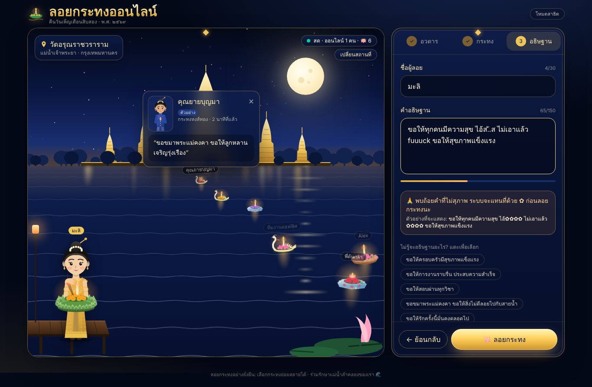

# 🪷 ลอยกระทงออนไลน์ · Interactive Online Loy Krathong

เว็บแอปลอยกระทงแบบเรียลไทม์ที่ใช้พร้อมกันได้หลายคน เลือกสถานที่บนแผนที่ แต่งอวตาร เลือกกระทง พิมพ์คำอธิษฐาน แล้วลอยไปพร้อมกับคนอื่นที่อยู่ "ริมน้ำเดียวกัน" ธีมน้ำเงินราตรี ทอง และแสงเทียน ออกแบบให้ใช้บนมือถือก่อน (mobile-first)

| เดสก์ท็อป | มือถือ | การ์ดที่ระลึก |
|---|---|---|
|  |  |  |

ลำดับแอนิเมชันตอนลอยกระทง: ยืนถือกระทง → นั่งพับเพียบ → วางลงน้ำ (น้ำกระเพื่อม) → พนมมืออธิษฐาน → กระทงลอยออกไป


> ภาพตัวอย่างถ่ายในโหมดสาธิตด้วยฟอนต์สำรองของเครื่อง ตัวจริงจะใช้ฟอนต์ **Charm** (หัวเรื่อง) และ **Mitr** (เนื้อหา) จาก Google Fonts

---

## เริ่มใช้งานใน 1 นาที

ต้องใช้ Node.js 20.19+ หรือ 22.12+ (ตามที่ Vite 8 กำหนด)

```bash
npm install
npm run dev          # เปิด http://localhost:5173
```

ยังไม่ต้องใส่คีย์ใด ๆ ก็ลองได้ทันทีในโหมดสาธิต
- **แผนที่**: ใช้ OpenStreetMap (Leaflet) ไม่ต้องใช้คีย์
- **เรียลไทม์**: ซิงก์ระหว่างแท็บในเบราว์เซอร์เดียวกัน เปิด 2 แท็บแล้วลอยกระทงจะเห็นกันทันที (แต่ละแท็บนับเป็นผู้ใช้ 1 คน)
- มีกระทงตัวอย่างลอยอยู่ก่อนแล้ว 5–7 ใบ ให้ลองชี้/แตะอ่านคำอธิษฐานได้

ใช้งานจริงกับผู้ใช้หลายเครื่อง: ตั้งค่า Firebase **หรือ** Supabase ตามหัวข้อด้านล่าง

```bash
npm run build && npm run preview   # สร้างไฟล์ production ไว้ที่ dist/
```

---

## ฟีเจอร์ครบตามโจทย์

| # | ฟีเจอร์ | อยู่ที่ไหนในโค้ด |
|---|---|---|
| 1 | **เลือกสถานที่บนแผนที่** — OpenStreetMap (Leaflet) ไม่ต้องใช้คีย์, หมุดสถานที่ยอดนิยม 8 แห่งพร้อมพิกัดจริง, ค้นหาสถานที่ทั่วไทย, แตะแผนที่เพื่อปักหมุดเอง, ปุ่ม "ใช้ตำแหน่งของฉัน", ฉากหลังเปลี่ยนตามสถานที่ (วัดอรุณ, สะพานพระราม 8, ชิงช้าสวรรค์เอเชียทีค, ประตูท่าแพ + โคมยี่เป็ง ฯลฯ) | `components/map/*`, `config/locations.js`, `components/river/SceneBackdrop.jsx` |
| 2 | **สร้างอวตาร** — เพศ 3 แบบ, โครงหน้า 4, ทรงผม 6, สีผม 4, สีผิว 6, ชุด 4 แบบ (ไทยจักรี / ราชปะแตน / ไทยประยุกต์ / ลำลองร่วมสมัย) + สีชุด 7 สี, ตัวอย่างเรียลไทม์, ปุ่มสุ่ม | `components/avatar/*`, `config/avatarOptions.js` |
| 3 | **เลือกและแต่งกระทง** — ใบตอง, ดอกบัว, ขนมปัง, น้ำแข็ง (รักษ์โลก), หงส์ทอง (แฟนซี) · สีดอกไม้ 5 สี · เทียน/ธูป 4 แบบ | `components/krathong/*`, `config/krathongOptions.js` |
| 4 | **ชื่อ + คำอธิษฐาน** — ชื่อ ≤ 30 ตัว, คำอธิษฐาน ≤ 150 ตัว (นับแบบไม่ตัดอีโมจิ), ตัวกรองคำหยาบไทย/อังกฤษ พร้อมแสดงตัวอย่างข้อความที่ถูกแทนที่ | `components/wish/WishForm.jsx`, `lib/profanity.js` |
| 5 | **ฉากแม่น้ำ + หลายผู้เล่น** — อวตารนั่งลงวางกระทง, น้ำกระเพื่อม, เปลวเทียนไหว, เงาจันทร์ระยิบระยับ, ดอกไม้ไฟ/โคมลอยตามสถานที่ · เห็นกระทง+ชื่อของทุกคนในสถานที่เดียวกันแบบเรียลไทม์, จำนวนคนออนไลน์, แจ้งเตือน "✨ … เพิ่งลอยกระทง" · ชี้/แตะกระทงเพื่อดูชื่อ อวตาร และคำอธิษฐาน | `components/river/*`, `realtime/*`, `hooks/useRealtimeRoom.js` |
| 6 | **บันทึกภาพที่ระลึก** — การ์ด 1080×1350 (4:5) วาดด้วย Canvas API: อวตาร, กระทง, ฉากสถานที่, ชื่อ, คำอธิษฐาน, วันที่ไทย, กรอบลายทอง · ดาวน์โหลด PNG/JPG · แชร์รูปตรงไป LINE/Facebook/IG ผ่าน Web Share API บนมือถือ · ลิงก์แชร์ Facebook / LINE / X | `lib/souvenirCard.js`, `components/share/SouvenirModal.jsx` |

**เทคโนโลยี**: React 19 + Vite 8 · Tailwind CSS v4 · Framer Motion 12 · Firebase Realtime Database หรือ Supabase Realtime · OpenStreetMap ผ่าน Leaflet (`react-leaflet`) + ค้นหาด้วย Nominatim

---

## โครงสร้างโปรเจกต์

```
src/
├─ App.jsx                     สลับหน้า "เลือกสถานที่" ↔ "ริมน้ำ" + จำค่าที่ผู้ใช้เลือกไว้
├─ pages/RiverStage.jsx        หน้าริมน้ำ: ฉากเรียลไทม์ + แผงปรับแต่ง + ลำดับการลอย
├─ config/
│  ├─ env.js                   อ่าน .env ที่เดียว + ตรวจว่าใช้ Firebase/Supabase/สาธิต
│  ├─ locations.js             สถานที่ยอดนิยม (พิกัดจริง) + ห้องสำหรับหมุดที่ปักเอง
│  ├─ scenes.js                บรรยากาศแต่ละฉาก (ความเร็วน้ำ, โคมลอย, ดอกไม้ไฟ, สีไฟสะท้อน)
│  ├─ avatarOptions.js         ตัวเลือกอวตาร
│  └─ krathongOptions.js       ตัวเลือกกระทง
├─ components/
│  ├─ map/                     LocationStep, LeafletMapKit (OpenStreetMap), Pin
│  ├─ avatar/                  Avatar (SVG + IK แขน + ท่าทาง), AvatarEditor
│  ├─ krathong/                Krathong (SVG 5 แบบ), KrathongPicker
│  ├─ wish/WishForm.jsx
│  ├─ river/                   RiverScene, SkyLayer, WaterLayer, SceneBackdrop,
│  │                           FloatingKrathongs, MyAvatarStage, KrathongInfoCard, Foreground
│  ├─ panel/CustomizePanel.jsx ขั้นตอน 1-2-3 + หน้าสำเร็จ
│  ├─ share/SouvenirModal.jsx
│  └─ ui/Options.jsx           ชิป/สวอตช์/การ์ดตัวเลือก (radio group เข้าถึงด้วยคีย์บอร์ดได้)
├─ realtime/
│  ├─ index.js                 เลือก adapter ตาม .env และ lazy-load SDK
│  ├─ firebaseAdapter.js       Realtime Database + presence + ชดเชยนาฬิกาเซิร์ฟเวอร์
│  ├─ supabaseAdapter.js       postgres_changes + Presence
│  ├─ localAdapter.js          โหมดสาธิต (BroadcastChannel + localStorage)
│  └─ schema.js                ตรวจ/ทำความสะอาดข้อมูลกระทงทุกแหล่ง
├─ hooks/                      useRealtimeRoom, usePersistentState, useElementSize
└─ lib/                        drift (ฟิสิกส์การลอย), profanity, thaiText, souvenirCard, color, ids
firebase/database.rules.json   กฎความปลอดภัย Firebase
supabase/schema.sql            ตาราง + RLS + เปิด Realtime สำหรับ Supabase
```

---

## การตั้งค่า API Key

คัดลอก `.env.example` เป็น `.env.local` แล้วกรอกเฉพาะส่วนที่ใช้ (ทุกค่าไม่บังคับ)

```bash
cp .env.example .env.local
```

> ค่าที่ขึ้นต้นด้วย `VITE_` จะถูกฝังลงในไฟล์ JavaScript ฝั่งเบราว์เซอร์ จึง**ต้อง**จำกัดสิทธิ์คีย์ตามขั้นตอนด้านล่าง (เป็นแนวทางปกติของ Firebase/Supabase anon key)

แผนที่ใช้ OpenStreetMap เสมอ จึงไม่ต้องตั้งค่าคีย์แผนที่

### 1) Firebase Realtime Database (เลือกอย่างใดอย่างหนึ่งกับ Supabase)

1. [Firebase Console](https://console.firebase.google.com/) → **Add project**
2. **Build → Realtime Database → Create database** เลือก region `asia-southeast1` (สิงคโปร์ ใกล้ไทย) → Start in **locked mode**
3. แท็บ **Rules** → วางเนื้อหาจาก [`firebase/database.rules.json`](firebase/database.rules.json) → Publish
   (อ่านได้ทุกคน, เพิ่มกระทงใหม่ได้แต่แก้/ลบของคนอื่นไม่ได้, ตรวจชนิดและความยาวข้อมูล, ห้ามปลอมเวลา)
4. **Project settings → General → Your apps → Web (</>)** → Register app → คัดลอกค่า `firebaseConfig`
5. ใส่ใน `.env.local`

```env
VITE_REALTIME_PROVIDER=firebase
VITE_FIREBASE_API_KEY=AIza...
VITE_FIREBASE_AUTH_DOMAIN=your-app.firebaseapp.com
VITE_FIREBASE_DATABASE_URL=https://your-app-default-rtdb.asia-southeast1.firebasedatabase.app
VITE_FIREBASE_PROJECT_ID=your-app
VITE_FIREBASE_APP_ID=1:123:web:abc
```

โครงสร้างข้อมูล
```
rooms/{roomId}/krathongs/{id}      { name, wish, avatar{}, krathong{}, createdAt, seed, lane, startX, startD, clientId }
rooms/{roomId}/presence/{tabId}    { at }   ← ลบอัตโนมัติด้วย onDisconnect เมื่อปิดแท็บ
```
แอปดึงเฉพาะกระทง 10 นาทีล่าสุด (สูงสุด 150 ใบ/สถานที่) ข้อมูลเก่าจะค้างในฐานข้อมูล ถ้าต้องการลบอัตโนมัติให้เขียน Scheduled Cloud Function ลบรายการที่ `createdAt` เก่ากว่า 1 วัน
สำหรับระบบจริงที่คนใช้เยอะ แนะนำเปิด **App Check** และ Anonymous Auth เพิ่ม

### 2) Supabase (ทางเลือกแทน Firebase)

1. [supabase.com](https://supabase.com/) → New project (region Singapore)
2. **SQL Editor → New query** → วางทั้งไฟล์ [`supabase/schema.sql`](supabase/schema.sql) → Run
   (สร้างตาราง `krathongs`, เปิด RLS ให้ anon อ่าน/เพิ่มได้ แต่แก้/ลบไม่ได้, เพิ่มตารางเข้า publication `supabase_realtime`)
3. **Project Settings → API** คัดลอก Project URL และ `anon` public key
4. ใส่ใน `.env.local`

```env
VITE_REALTIME_PROVIDER=supabase
VITE_SUPABASE_URL=https://xxxx.supabase.co
VITE_SUPABASE_ANON_KEY=eyJhbGciOi...
```

ใช้ Supabase Realtime 2 ส่วน: `postgres_changes` (รับกระทงใหม่) และ Presence (นับคนออนไลน์ต่อสถานที่)

> ถ้าไม่ระบุ `VITE_REALTIME_PROVIDER` แอปจะเลือกเองจากค่าที่กรอก (Firebase ก่อน → Supabase → โหมดสาธิต) และถ้าเชื่อมต่อไม่สำเร็จจะถอยไปโหมดสาธิตพร้อมแสดงสถานะ "ออฟไลน์" ที่มุมขวาบนของฉาก

---

## ระบบเรียลไทม์ทำงานอย่างไร

- **ห้อง = สถานที่**: สถานที่ยอดนิยมใช้ id ของตัวเอง หมุดที่ปักเองจะปัดพิกัดเป็นตาราง ~1 กม. (`geo_13p74_100p53`) คนใกล้กันจึงเจอกัน ถ้าปักใกล้สถานที่ยอดนิยมไม่เกิน 1.2 กม. จะพาไปรวมห้องนั้นอัตโนมัติ
- **ไม่ส่งตำแหน่งทุกเฟรม**: ส่งแค่ครั้งเดียวตอนลอย (เวลา + ค่าสุ่มเลน/ความเร็ว) แล้วทุกเครื่องคำนวณตำแหน่งจากเวลาเองใน `lib/drift.js` จึงประหยัดและทุกคนเห็นตรงกัน (Firebase ชดเชยนาฬิกาด้วย `.info/serverTimeOffset`)
- **ลื่นบนมือถือ**: ตำแหน่งกระทงอัปเดตด้วย `useAnimationFrame` ของ Framer Motion แล้วเขียน `transform` ลง DOM ตรง ๆ ไม่ re-render React ทุกเฟรม
- **Optimistic**: กระทงของเราขึ้นจอทันที ส่งเซิร์ฟเวอร์ตามหลัง และกันส่งรัวด้วยคูลดาวน์ 8 วินาที
- กระทงลอยให้เห็น 10 นาที แล้วค่อย ๆ จางหาย (ปรับได้ที่ `KRATHONG_LIFETIME_MS`)

## ตัวกรองคำหยาบ

`lib/profanity.js` จับคำแม้พิมพ์เลี่ยง เช่น `ค.ว.ย`, `ค ว ย`, `fuuuck`, `$h1t`, `F*U*C*K` และมีข้อยกเว้นคำปกติที่บังเอิญมีคำหยาบซ้อน (หีบ, สัดส่วน, เชี่ยวชาญ, เหี่ยว, แม่งาน, shiitake, cocktail ฯลฯ) คำที่พบจะถูกแทนด้วย ✿ โดยไม่บล็อกการส่ง และกรองซ้ำอีกรอบตอนแสดงผลข้อมูลจากคนอื่น
เพิ่มคำได้ที่ `THAI_WORDS` / `EN_WORDS` — สำหรับระบบจริงควรกรองซ้ำฝั่งเซิร์ฟเวอร์ด้วย (Cloud Functions trigger หรือ Postgres trigger)

## การ์ดภาพที่ระลึก: ทำไมใช้ Canvas API แทน html2canvas

- อวตาร/กระทง/ฉากเป็น SVG จึงวาดลง Canvas ได้คมชัดที่ความละเอียดจริง 1080×1350
- html2canvas ยังอ่านสี `oklch()` ที่ Tailwind v4 ใช้เป็นค่าเริ่มต้นไม่ได้ และมักเพี้ยนกับ `backdrop-filter`
- ตัดบรรทัดภาษาไทยถูกต้องด้วย `Intl.Segmenter`
- ปุ่ม "แชร์ภาพ" ใช้ Web Share API (มือถือส่วนใหญ่) ส่วนลิงก์ Facebook/LINE/X แนบได้แค่ลิงก์ (แพลตฟอร์มไม่อนุญาตให้เว็บแนบรูปผ่าน URL)

## ปรับแต่งเพิ่มเติม

- **เพิ่มสถานที่**: เพิ่ม object ใน `POPULAR_LOCATIONS` (`config/locations.js`) และเลือก `scene` ที่มีอยู่ หรือสร้างฉากใหม่ใน `SceneBackdrop.jsx` + `config/scenes.js`
- **เพิ่มแบบกระทง**: เพิ่มใน `KRATHONG_TYPES` แล้วเขียนคอมโพเนนต์ SVG ใน `Krathong.jsx` (map ใน `BODIES`)
- **เพิ่มชุด/ทรงผม**: `config/avatarOptions.js` + ฟังก์ชัน `Upper` / `HairFront` ใน `Avatar.jsx`
- **ธีมสี/ฟอนต์**: แก้ `@theme` ใน `src/index.css`

## Deploy

Vercel / Netlify / Firebase Hosting / Cloudflare Pages ได้ทั้งหมด (เป็น static site)
- Build command: `npm run build` · Output: `dist`
- ใส่ environment variables ชุดเดียวกับ `.env.local` ในหน้าตั้งค่าของผู้ให้บริการ

## หมายเหตุ

- การค้นหาสถานที่ใช้ Nominatim ของ OpenStreetMap ซึ่งจำกัด 1 ครั้ง/วินาที แอปจึงค้นหาเมื่อกด Enter เท่านั้น ถ้าผู้ใช้เยอะควรตั้ง geocoder ของตัวเองหรือใช้บริการ Nominatim แบบเสียเงิน
- เคารพการตั้งค่า "ลดการเคลื่อนไหว" (prefers-reduced-motion) ของระบบ
- ข้อความ UI เป็นภาษาไทยทั้งหมด รองรับคีย์บอร์ดและ screen reader ในตัวเลือกหลัก
